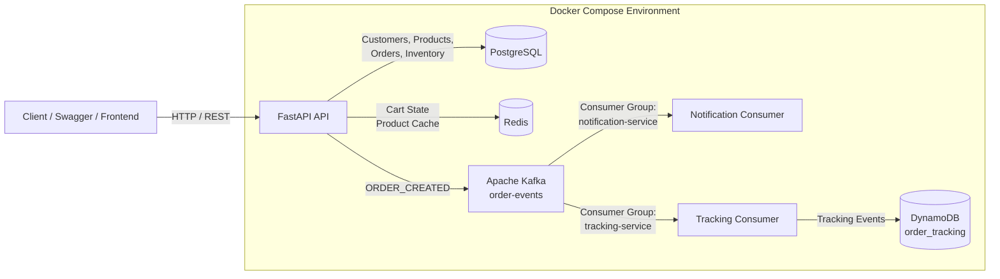
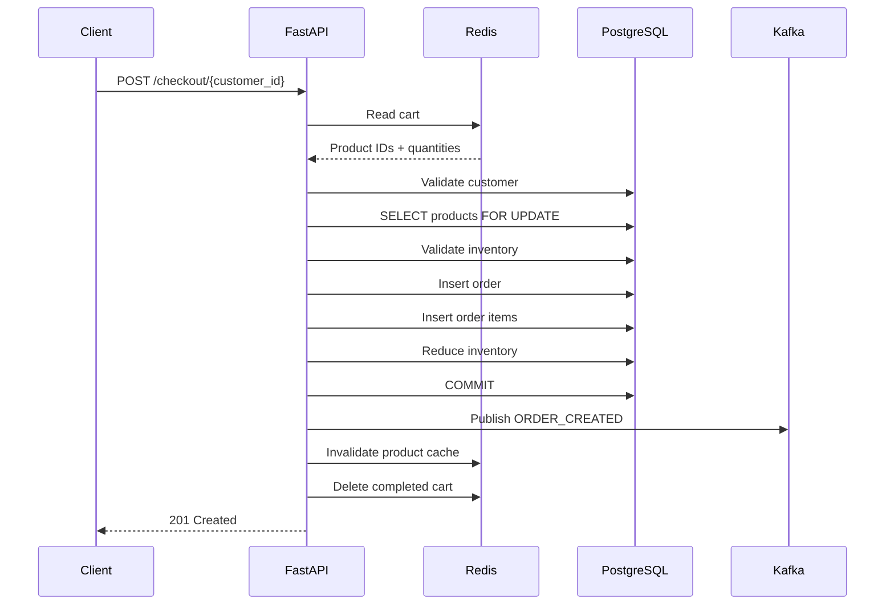

# NexCommerce — Event-Driven E-Commerce Backend

NexCommerce is a containerized, event-driven e-commerce backend designed to demonstrate how modern backend systems combine relational storage, in-memory state, event streaming, and NoSQL persistence to solve different parts of a real-world ordering workflow.

The system is built with **FastAPI, PostgreSQL, Redis, Apache Kafka, DynamoDB Local, and Docker Compose**.

---

## 1. Business Problem

An online retail platform needs to support the following customer journey:

1. Browse products.
2. Add or update products in a shopping cart.
3. View the current cart and pricing.
4. Checkout safely without overselling inventory.
5. Persist the final order and order items.
6. Notify downstream systems that an order was created.
7. Maintain an independent order-tracking history.
8. Keep frequently requested product data fast without making cached data the source of truth.

A single database can technically support much of this, but using one technology for every concern creates unnecessary coupling and makes it difficult to scale individual workloads independently.

NexCommerce separates these responsibilities across purpose-built components.

---

## 2. Solution Overview

NexCommerce uses the following design:

| Technology | Responsibility |
|---|---|
| **FastAPI** | REST API and business orchestration |
| **PostgreSQL** | System of record for customers, products, inventory, orders, and order items |
| **Redis** | Shopping-cart state and product caching |
| **Apache Kafka** | Asynchronous domain-event delivery |
| **DynamoDB** | Order-tracking event history |
| **Docker Compose** | Local orchestration and service networking |

The key architectural principle is:

> Each technology is used only where its characteristics solve a specific business problem.

---

## 3. High-Level Architecture



---

## 4. Component Responsibilities

### FastAPI

FastAPI is the application layer responsible for:

- validating API requests;
- coordinating PostgreSQL and Redis operations;
- enforcing checkout rules;
- calculating order totals using trusted product prices;
- publishing business events to Kafka;
- returning REST responses to clients.

FastAPI does **not** treat Redis, Kafka, or DynamoDB as replacements for PostgreSQL. It coordinates them according to their role.

---

### PostgreSQL — Source of Truth

PostgreSQL stores permanent relational business data.

Core entities:

```text
customers
    |
    | 1:N
    v
orders
    |
    | 1:N
    v
order_items
    |
    | N:1
    v
products
```

Typical PostgreSQL responsibilities include:

- customer identity;
- product information;
- current product price;
- inventory quantity;
- orders;
- order items;
- relational integrity;
- checkout transactions.

PostgreSQL remains authoritative for inventory and pricing.

---

### Redis — Cart State and Cache

Redis has two separate responsibilities.

#### Shopping Cart

A customer's cart is stored as a Redis hash:

```text
cart:1

product_id    quantity
----------    --------
1             2
5             1
```

The cart is temporary state and can expire using a TTL.

Example commands represented by the API:

```text
HSET
HGETALL
HINCRBY
HDEL
EXPIRE
DEL
```

#### Product Cache

Single-product reads use the cache-aside pattern:

```text
GET /products/{id}
        |
        v
      Redis
      /   \
    HIT   MISS
     |      |
     |      v
     |  PostgreSQL
     |      |
     |      v
     |  Cache Result
     |      |
     +------+
        |
        v
     Response
```

PostgreSQL remains the source of truth.

Cached product data is invalidated after operations such as checkout that modify inventory.

---

### Apache Kafka — Domain Events

Kafka decouples checkout from downstream processing.

After a successful order transaction, FastAPI publishes an event such as:

```json
{
  "event_id": "generated-uuid",
  "event_type": "ORDER_CREATED",
  "event_version": 1,
  "occurred_at": "2026-10-12T02:50:00+00:00",
  "order_id": 25,
  "customer_id": 1,
  "customer_name": "Customer Name",
  "total_amount": "290.00",
  "items": [
    {
      "product_id": 1,
      "product_name": "Keyboard",
      "quantity": 2,
      "unit_price": "120.00",
      "line_total": "240.00"
    }
  ]
}
```

Topic:

```text
order-events
```

Using Kafka prevents the checkout API from directly depending on notification or tracking services.

---

### Notification Consumer

The notification consumer runs independently from FastAPI.

It belongs to the Kafka consumer group:

```text
notification-service
```

When it receives:

```text
ORDER_CREATED
```

it can perform work such as:

```text
Send order confirmation email
Send SMS
Send push notification
```

The current implementation can simulate this behavior through logs.

If the notification consumer is unavailable, checkout can still succeed because FastAPI does not call it directly.

---

### DynamoDB — Tracking Timeline

DynamoDB stores the historical sequence of order-tracking events.

Primary access pattern:

> Retrieve the complete tracking timeline for a known order in chronological order.

## 5. End-to-End Customer Workflow

### Step 1 — Browse Products

```text
Client
  |
  v
GET /products/{id}
  |
  v
Redis Cache
  |
  +-- HIT  -> Return cached product
  |
  +-- MISS -> PostgreSQL -> Cache -> Return
```

---

### Step 2 — Add Products to Cart

```text
Client
  |
  v
POST /cart/{customer_id}/items
  |
  +--> Validate customer in PostgreSQL
  |
  +--> Validate product in PostgreSQL
  |
  v
Redis
  |
  v
cart:{customer_id}
```

Redis stores only product IDs and quantities.

Product name, price, and stock remain owned by PostgreSQL.

---

### Step 3 — View Cart

```text
Redis
  |
  | product IDs + quantities
  v
FastAPI
  |
  v
PostgreSQL
  |
  | product names + current prices + stock
  v
Combined Cart Response
```

This ensures the cart reflects current product information.

---

### Step 4 — Checkout

Checkout converts temporary Redis state into permanent PostgreSQL business data.



Important rule:

> The PostgreSQL transaction commits before temporary Redis cart data is removed.

This protects the customer from losing the cart if the permanent order fails.

---

## 6. Checkout Consistency

Checkout involves multiple database changes:

```text
Create order
Create order items
Reduce product inventory
```

These changes are handled as one PostgreSQL transaction.

```text
Everything succeeds
        |
        v
      COMMIT
```

If anything fails:

```text
Any operation fails
        |
        v
     ROLLBACK
```

This prevents states such as:

```text
Order exists             YES
Order items complete     NO
Inventory updated        PARTIALLY
```

---

## 7. Inventory Concurrency

Checkout locks product records before validating inventory:

```sql
SELECT
    product_id,
    name,
    price,
    stock_quantity
FROM products
WHERE product_id = %s
FOR UPDATE;
```

This prevents two concurrent checkouts from independently reading the same available stock and overselling it.

Product rows are locked in a consistent product-ID order to reduce deadlock risk.

---

## 8. Why the Cart Does Not Reserve Inventory

Adding a product to a cart does not guarantee the product remains available.

Example:

```text
Available stock: 5

Customer A adds 4 to cart.

Customer B purchases 3.

Current stock: 2.
```

Customer A still has quantity `4` in Redis.

The authoritative inventory validation happens during checkout using PostgreSQL.

This keeps carts lightweight and avoids long-lived inventory locks.

---

## 9. Event-Driven Processing

After an order is committed:

```text
PostgreSQL
    |
    | COMMIT
    v
FastAPI
    |
    | ORDER_CREATED
    v
Kafka
```

Multiple independent consumer groups can process the same event:

```text
                     order-events
                          |
               +----------+----------+
               |                     |
               v                     v
      notification-service     tracking-service
               |                     |
               v                     v
         Notification             DynamoDB
```

This architecture provides loose coupling.

FastAPI does not need to know how notifications or tracking are implemented.

---

## 10. Data Ownership

A critical architectural rule in NexCommerce is clear data ownership.

| Data | Owner |
|---|---|
| Customer | PostgreSQL |
| Product | PostgreSQL |
| Product price | PostgreSQL |
| Inventory | PostgreSQL |
| Order | PostgreSQL |
| Order items | PostgreSQL |
| Shopping cart | Redis |
| Cached product copy | Redis |
| Domain-event transport | Kafka |
| Tracking event history | DynamoDB |

Redis cached data is never treated as authoritative for price or inventory during checkout.

---

## 11. Project Structure

```text
Project-SBNS/
|
├── app/
│   ├── __init__.py
│   ├── main.py
│   ├── db.py
│   ├── redis_client.py
│   ├── kafka_producer.py
│   ├── schemas.py
│   |
│   └── routers/
│       ├── __init__.py
│       ├── products.py
│       ├── customers.py
│       ├── orders.py
│       ├── cart.py
│       └── checkout.py
│
├── consumers/
│   ├── notification_consumer.py
│   └── tracking_consumer.py
│
├── docker/
│   └── dynamodb/
│
├── Dockerfile
├── docker-compose.yml
├── requirements.txt
├── .env.example
├── .gitignore
└── README.md
```

---

## 12. API Surface

### Health

```http
GET /
GET /health
```

### Products

```http
GET  /products
GET  /products/{product_id}
POST /products
```

### Customers

```http
GET  /customers
GET  /customers/{customer_id}
POST /customers
GET  /customers/{customer_id}/orders
```

### Orders

```http
GET /orders/{order_id}
```

### Cart

```http
POST   /cart/{customer_id}/items
GET    /cart/{customer_id}
PUT    /cart/{customer_id}/items/{product_id}
DELETE /cart/{customer_id}/items/{product_id}
DELETE /cart/{customer_id}
```

### Checkout

```http
POST /checkout/{customer_id}
```

---

## 13. Docker Networking

Services communicate using Docker Compose service names.

Inside Docker:

```text
PostgreSQL -> postgres:5432
Redis      -> redis:6379
Kafka      -> kafka:19092
DynamoDB   -> dynamodb:8000
```

From the Windows host:

```text
FastAPI    -> localhost:8000
PostgreSQL -> localhost:5432
Redis      -> localhost:6379
Kafka      -> localhost:9092
DynamoDB   -> localhost:8001
```

Important:

> `localhost` inside a container refers to that container itself, not another Docker service.

---

## 14. Environment Configuration

Sensitive and environment-specific configuration is stored outside the Compose file.

Example `.env`:

```env
POSTGRES_USER=sbns_user
POSTGRES_PASSWORD=change-me
POSTGRES_DB=sbns

POSTGRES_HOST=localhost
POSTGRES_PORT=5432

REDIS_HOST=localhost
REDIS_PORT=6379

CART_TTL_SECONDS=604800
PRODUCT_CACHE_TTL_SECONDS=60

KAFKA_BOOTSTRAP_SERVERS=localhost:9092
KAFKA_ORDER_TOPIC=order-events
```

Docker Compose overrides service addresses where required:

```yaml
environment:
  POSTGRES_HOST: postgres
  REDIS_HOST: redis
  KAFKA_BOOTSTRAP_SERVERS: kafka:19092
```

The `.env` file should not be committed to source control when it contains secrets.

---

## 15. Running the Platform

Build and start the services:

```bash
docker compose up -d --build
```

Check status:

```bash
docker compose ps
```

Expected services include:

```text
sbns-api
sbns-postgres
sbns-redis
sbns-kafka
sbns-notification-consumer
sbns-dynamodb
```

Open Swagger:

```text
http://localhost:8000/docs
```

---

## 16. Example Business Scenario

A customer adds:

```text
Keyboard × 2
Mouse × 1
```

to the cart.

Redis:

```text
cart:1

1 -> 2
2 -> 1
```

At checkout:

1. FastAPI reads the Redis cart.
2. PostgreSQL validates the customer.
3. PostgreSQL locks both product rows.
4. Current inventory is checked.
5. Current PostgreSQL prices are used.
6. An order is inserted.
7. Order items are inserted.
8. Inventory is reduced.
9. PostgreSQL commits the transaction.
10. FastAPI publishes `ORDER_CREATED` to Kafka.
11. Redis product cache entries are invalidated.
12. The completed Redis cart is deleted.
13. The notification consumer receives the event.
14. The tracking consumer can persist the event to DynamoDB.

The customer receives a successful response without waiting for downstream notification or tracking processing.

---

## 17. Failure Handling

### Invalid Customer

```text
404 Customer not found
```

### Invalid Product

```text
404 Product not found
```

### Empty Cart

```text
400 Cart is empty
```

### Insufficient Inventory

```text
409 Conflict
```

The PostgreSQL transaction is not committed and the Redis cart remains intact.

### Notification Service Down

Checkout still succeeds because notification processing is decoupled through Kafka.

### Redis Product Cache Missing

FastAPI falls back to PostgreSQL and repopulates the cache.

---

## 18. Important Distributed-System Consideration

The current architecture commits PostgreSQL and then publishes to Kafka:

```text
PostgreSQL COMMIT
       |
       v
Kafka publish
```

---

## 19. Architecture Decisions

### Why PostgreSQL for Orders?

Orders have strong relationships and transactional consistency requirements.

### Why Redis for Cart?

Cart data is temporary, changes frequently, and benefits from fast key-based access and TTL expiration.

### Why Redis for Product Cache?

Frequently accessed product reads can avoid unnecessary database calls while PostgreSQL remains authoritative.

### Why Kafka?

An order-created event can drive multiple downstream capabilities without tightly coupling them to checkout.

### Why DynamoDB for Tracking?

Tracking is naturally an access-pattern-driven chronological event history keyed by order.

### Why Docker Compose?

Docker Compose provides repeatable local orchestration and service-to-service networking without requiring each dependency to be installed directly on the host.

---

## 20. Key Engineering Concepts Demonstrated

This project demonstrates:

- REST API design;
- relational data modelling;
- primary and foreign keys;
- transaction boundaries;
- rollback and commit;
- pessimistic row locking with `FOR UPDATE`;
- inventory consistency;
- Redis hashes;
- Redis TTL;
- cache-aside pattern;
- cache invalidation;
- event-driven architecture;
- Kafka producers;
- Kafka consumers;
- Kafka topics;
- consumer groups;
- event keys and offsets;
- asynchronous processing;
- DynamoDB partition and sort keys;
- access-pattern-driven NoSQL design;
- container networking;
- environment-based configuration;
- service decoupling;
- distributed-system failure boundaries.

---